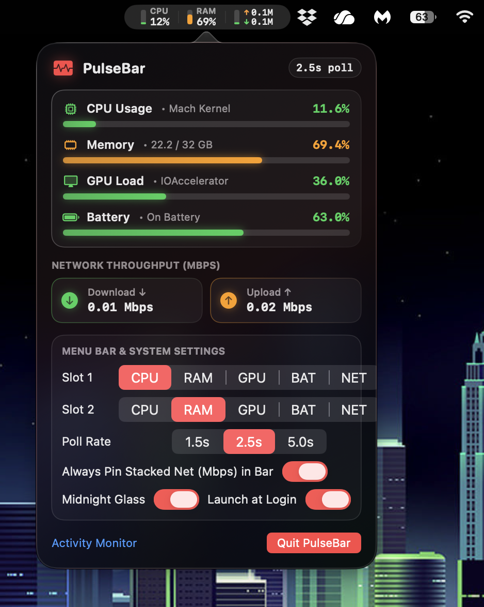

<div align="center">

# ⚡ PulseBar

**A lightweight, native macOS menu bar system monitor with a Midnight Liquid Glass UI.**

[](https://www.apple.com/macos/)
[](https://swift.org)
[](LICENSE)
[](https://github.com/RyzerG/PulseBar/actions/workflows/codeql.yml)


</div>

---

**PulseBar** is an ultra-low-overhead hardware telemetry utility that lives exclusively in your macOS menu bar. Instead of spawning heavy background shell scripts (`top`, `vm_stat`), PulseBar interfaces directly with **Darwin Mach kernel APIs** and **IOKit** in Swift—keeping RAM usage around ~15 MB and background CPU load below 0.2%.

## 📑 Table of Contents

- [Features](#-features)
- [System Architecture](#-system-architecture)
- [Requirements](#-requirements)
- [Installation & Building](#-installation--building)
- [Usage & Customization](#-usage--customization)
- [Project Structure](#-project-structure)
- [License](#-license)

---

## ✨ Features

* **Dual Customizable Menu Bar Slots:** Choose any two primary metrics (`CPU`, `RAM`, `GPU`, `BAT`, or `NET`) to display live in your macOS status bar.
* **Dynamic Color-Coded Load Bars:** Each menu bar stat is paired with an animated vertical gauge that dynamically transitions between **Green** (<60%), **Orange** (60–85%), and **Red** (>85%) based on real-time load (inverted for battery charge).
* **Stacked Network Throughput (Mbps):** Pin real-time upload (`↑`) and download (`↓`) speeds in Megabits per second directly to the menu bar or monitor them inside the pop-out dashboard.
* **Midnight Liquid Glass Pop-Out:** Built with `NSVisualEffectView` (`.hudWindow` + `.behindWindow` blending), translucent frosted cards, crimson accents, and diagonal specular borders.
* **Zero-Bloat Background Execution:** Runs as a native agent app (`LSUIElement = YES`) with no Dock icon clutter and coalesced `RunLoop` timers (`0.5s` tolerance) to preserve MacBook battery life.
* **Native Launch at Login:** Integrated directly with macOS `SMAppService` for one-click startup configuration.

---

## 🔧 System Architecture

PulseBar avoids `Process` / CLI wrappers entirely and queries hardware metrics straight from the operating system kernel:

| Metric | Underlying macOS API | Details |
| :--- | :--- | :--- |
| **CPU Usage** | `host_processor_info` (`PROCESSOR_CPU_LOAD_INFO`) | Calculates real-time user, system, nice, and idle tick deltas across all logical cores. |
| **Memory (RAM)** | `host_statistics64` (`HOST_VM_INFO64`) | Computes active, wired, and compressor page counts against physical memory. |
| **GPU Load** | `IOKit` (`IOAccelerator`) | Reads `PerformanceStatistics` utilization dictionaries directly from Apple Silicon / Intel graphics accelerators. |
| **Battery** | `IOKit.ps` (`IOPSCopyPowerSourcesInfo`) | Tracks current capacity percentage and AC charging state. |
| **Network** | `Darwin` (`getifaddrs` / `AF_LINK`) | Aggregates byte counters (`ifi_ibytes` / `ifi_obytes`) across physical `en*` interfaces and converts deltas to Mbps. |

---

## 💻 Requirements

* **macOS:** 14.0 (Sonoma) or later
* **Xcode:** 16.0 or later (to build from source)
* **Architecture:** Universal (Apple Silicon `arm64` & Intel `x86_64`)

---

## 🚀 Installation & Building

### Build from Source (Xcode)

1. **Clone the repository:**
   ```bash
   git clone [https://github.com/RyzerG/PulseBar.git](https://github.com/RyzerG/PulseBar.git)
   cd PulseBar
   ```

2. **Open the project in Xcode:**
   ```bash
   open PulseBar.xcodeproj
   ```

3. **Build and Run:**
   * Select the **`PulseBar`** scheme and set the destination to **My Mac**.
   * Press **`Cmd + R`** to compile and launch. PulseBar will appear immediately in your top-right macOS menu bar.

### Export as a Standalone App

To install PulseBar permanently in your `/Applications` folder without running Xcode:

```bash
xcodebuild -project PulseBar.xcodeproj \
  -scheme PulseBar \
  -configuration Release \
  -derivedDataPath .build \
  CODE_SIGN_IDENTITY="" \
  CODE_SIGNING_REQUIRED=NO \
  CODE_SIGNING_ALLOWED=NO \
  build

cp -R .build/Build/Products/Release/PulseBar.app /Applications/
```

---

## 🎛️ Usage & Customization

Click the **PulseBar** widget in your menu bar to open the Liquid Glass popover dashboard:

* **Slot 1 & Slot 2 Pickers:** Instantly swap which two metrics (`CPU`, `RAM`, `GPU`, `BAT`, `NET`) appear in your menu bar.
* **Poll Rate:** Adjust the background telemetry refresh interval between `1.5s`, `2.5s` (default), and `5.0s`.
* **Always Pin Stacked Net (Mbps) in Bar:** Keep a dedicated 3rd menu bar module showing stacked `↑ Upload` and `↓ Download` speeds alongside your two primary slots.
* **Midnight Glass:** Toggle between the signature dark crimson/midnight glass theme and standard light appearance.
* **Launch at Login:** Register or unregister PulseBar as a macOS login item.

*(Note: All preferences are automatically persisted across restarts via `UserDefaults`.)*

---

## 📂 Project Structure

```text
PulseBar/
├── PulseBar/
│   ├── PulseBarApp.swift          # App entry point, NSStatusItem & NSPopover controller
│   ├── SystemMonitor.swift        # Mach kernel, IOKit & getifaddrs telemetry engine
│   ├── MenuBarLabelView.swift     # Compact menu bar pills & dynamic vertical load bars
│   ├── PopoverDashboardView.swift # Liquid Glass NSVisualEffectView pop-out UI & settings
│   └── Assets.xcassets/           # App icons and accent color definitions
├── PulseBar.xcodeproj/            # Xcode project configuration
├── LICENSE                        # MIT License
└── README.md                      # Project documentation
```

---

## 📄 License

Distributed under the **MIT License**. See [`LICENSE`](LICENSE) for full details.